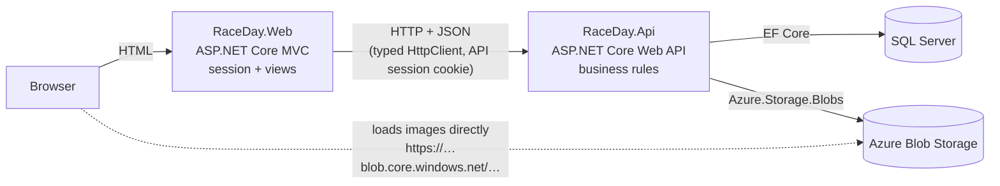

# RaceDay – Part 3: MVC web application

[](../../actions/workflows/ci.yml)

RaceDay is an event management platform for South African road running, walking and cycling events.
**Part 3** adds the web front end: an **ASP.NET Core MVC** application that consumes the Part 2 REST API, gives
**Organisers** and **Participants** their own role-based interface (styled to the RaceDay pink-and-lavender prototype), stores event banners and profile pictures in
**Azure Blob Storage** (through the API) and runs in a **Docker** container.

| | |
|---|---|
| **YouTube demo (unlisted)** | `PASTE-YOUR-UNLISTED-YOUTUBE-LINK-HERE` |
| **CI status** | badge above, plus screenshot: `docs/ci-green-build.png` *(add it after your first green run)* |

---

## 1. Architecture



| Project | Responsibility | Never contains |
|---|---|---|
| `RaceDay.Api` | Database, business rules, session auth, **Azure Blob writes** | Razor views |
| `RaceDay.Web` | Pages, forms, session state, HTTP calls to the API | `DbContext`, SQL, `Azure.Storage.*` |
| `RaceDay.Tests` | API unit/integration tests (SQLite in memory, fake blob storage) | – |
| `RaceDay.Web.Tests` | MVC tests: helpers, API client, role filters, full web app against a fake API, **architecture guard** | – |

**The boundary is enforced, not just promised.** `RaceDay.Web.csproj` references nothing but that one allow-listed package, and
`RaceDay.Web.Tests/ArchitectureTests.cs` plus a CI step fail the build if EF Core, SqlClient or the Azure SDK ever
appear in the MVC project. The only package it references is `System.Net.Http.Json` (already part of .NET, added on request and allow-listed in the test).

### How the MVC app talks to the API
* All HTTP lives in one place: `RaceDay.Web/Services/RaceDayApiClient.cs`, a **typed client** registered with
  `IHttpClientFactory`. Controllers depend on `IRaceDayApiClient` and never see `HttpClient`.
* **Sessions.** On login the MVC app calls `POST /api/auth/login`, keeps the API's `.RaceDay.Session` cookie in *its own*
  server-side session next to `UserId`, `Role` and `DisplayName`, and a `DelegatingHandler`
  (`ApiSessionHandler`) attaches that cookie to every API call. Each browser user is therefore logged in to the API as
  themselves. (The pooled handler has `UseCookies = false`, so one user's cookie can never leak to another.)
* **Role-based access.** `[RequireRole("Organiser")]` / `[RequireRole("Participant")]` / `[RequireLogin]` filters read the
  role from the session. Anonymous visitors go to the login page (and come back afterwards); a signed-in user with the
  wrong role is sent home with a message. The navigation bar in `_Layout.cshtml` also shows a different menu per role.
* **Expired sessions / API offline.** `ApiExceptionFilter` turns API 401s into "please log in again", 404s into a friendly
  not-found page and unreachable-API errors into a "we're warming up" page. Users never see a stack trace or raw error.
* **Uploads.** The browser posts the image to MVC, MVC **streams** it (`StreamContent`) to `POST /api/files/banner` or
  `/api/files/profile-picture`, the API verifies the bytes really are an image, stores it in Azure Blob Storage and returns
  the blob URL. MVC saves that URL with the event/profile through the API and shows it with ``.

---

## 2. Features

### Look and feel (from the prototype)
Pink/lavender theme, Playfair Display + DM Sans, a left sidebar menu per role (collapses to a burger menu on phones), a top bar with **search** and a **notifications bell**
(built from real API data), pop-up **confirm** and **enrol** dialogs, toast messages, medal-coloured positions, and emoji-on-gradient cards for events without a banner.

### Everyone
* **Race Weather** page: pick an event and see the forecast for race day (or today's conditions if it is more than 16 days away), a conditions rating and
  race-day tips. The API fetches it from [Open-Meteo](https://open-meteo.com) (free, no key); the web app only calls `GET /api/events/{id}/weather`.
* Home page: upcoming events as cards with **search, location and type filters** and paging.
* Event page: banner (from Azure), description, categories with fee and places left, results leaderboard for past events.
* Register (Participant, or Organiser with the organiser code) and log in.

### Organiser (own menu: Dashboard · Manage Events · Create Event · Capture Results · Race Weather)
| Page | What it does |
|---|---|
| **Dashboard** | Totals (events managed, enrolments, results captured, entry fees), next event, and a card per event with its own enrolments / results / fees figures |
| **Manage events / Create event** | Create / **edit** / **delete** events: name, description, date, location, distance, type, **banner upload** with live preview. **Categories can be added on the same Create page** |
| **Categories** | Add / edit / delete age or distance categories per event, with quick-fill buttons (5 km, 10 km, Under 20, 50+ …) |
| **Enrolments** | Everyone enrolled for an event with category and colour-coded status; filter by status; cancel an enrolment |
| **Results entry** | Capture finish time and position (or DNF/DSQ) for each confirmed enrolment. Saving **publishes** immediately. Locked until the event date has passed |
| **Profile** | Update details and profile picture |

### Participant (own menu: Browse Events · My Enrolments · My Results · Race Weather)
| Page | What it does |
|---|---|
| **Browse Events** | Upcoming events with filters, an **Enter event** pop-up with category choice, and your entry / fees / finished-races totals |
| **Event details** | Full information and categories; **Enrol** button per category records the enrolment immediately |
| **My Enrolments** | All / Upcoming / Past tabs; every enrolment with its status; cancel a future enrolment (confirm pop-up) |
| **My Results** | Personal-best banner and race history: event, date, category, finish time and position as **“47th out of 312 finishers”** |
| **Profile** | View/update personal information and **profile picture** |

### Colour-coded statuses (one helper, used by every page)
`Confirmed` / `Finished` = green · `Pending` / `DNF` = amber · `Cancelled` / `DSQ` = red (`Helpers/Display.cs`, `_StatusBadge.cshtml`).

---

## 3. Run it locally (no Docker)

**Prerequisites:** .NET 10 SDK, SQL Server (the default connection string uses LocalDB, installed with Visual Studio).

```bash
# 1. Start the API   (http://localhost:5146, Swagger at /swagger)
dotnet run --project RaceDay.Api --launch-profile http

# 2. In a second terminal, start the web app   (http://localhost:5080)
dotnet run --project RaceDay.Web
```
The API creates the database, adds the Part 3 image columns to an existing Part 2 database automatically, and seeds demo data.

**Check that everything is really connected:** with both apps running, `powershell -ExecutionPolicy Bypass -File scripts\smoke-test.ps1` logs in as an organiser and a participant through the web app and reports PASS/FAIL for each step.

**Demo accounts** (password `Password123!`)

| Role | Email |
|---|---|
| Organiser | `thabo.organiser@raceday.co.za` / `lindiwe.organiser@raceday.co.za` |
| Participant | `sipho.runner@raceday.co.za` / `anke.cyclist@raceday.co.za` |

Registering a new Organiser needs the code `RACEDAY-ORGANISER-2026` (`Auth:OrganiserRegistrationCode` in the API's `appsettings.json`).

---

## 4. Azure Blob Storage setup (needed for banner and profile-picture uploads)

1. In the Azure portal create a **Storage account** (Standard, LRS is fine).
2. *Settings → Configuration →* set **Allow Blob anonymous access = Enabled** and save (images are served straight to the browser).
3. *Security + networking → Access keys →* copy a **connection string**.
4. Give it to the **API** (never to the web project, and never commit it):
   ```bash
   dotnet user-secrets set "AzureBlobStorage:ConnectionString" "<paste connection string>" --project RaceDay.Api
   ```
   (or set the environment variable `AzureBlobStorage__ConnectionString`).
5. Restart the API. On the first upload it creates the container `raceday-images` with public read access for blobs.

Uploaded images get a random name and a URL like `https://<account>.blob.core.windows.net/raceday-images/banners/<guid>.jpg`,
which is saved on the event (`BannerUrl`) or profile (`ProfilePictureUrl`). Without a connection string the API answers
**503 “Image storage is not configured”** and the web app shows that message in the form; everything else still works.

Upload rules (checked by the API): JPEG, PNG, GIF or WebP, up to 5 MB; the type is decided from the file's bytes, not its name.

---

## 5. Docker

### The MVC container (the one required by the brief)
The web app needs to know where the API is. `ApiBaseUrl` is passed in when the container starts.

**Step 1 – start the API so the container can reach it.** From inside a container, `localhost` is the container itself, and an API
bound only to `localhost` refuses connections from Docker. Bind the API to all interfaces:
```bash
dotnet run --project RaceDay.Api --urls "http://0.0.0.0:5146"
```
(Windows may ask to allow the app through the firewall – allow it for private networks.)

**Step 2 – build and run the web container (single command to start):**
```bash
docker build -t raceday-web ./RaceDay.Web
docker run -d --name raceday-web -p 5080:8080 --add-host=host.docker.internal:host-gateway -e ApiBaseUrl=http://host.docker.internal:5146/ raceday-web
```
Open **http://localhost:5080**. The container behaves exactly like the local run because every setting comes from `ApiBaseUrl`.
Stop it with `docker rm -f raceday-web`.

### Whole stack with one command (SQL Server + API + web)
```bash
docker compose up --build
```
Web → http://localhost:5080 · API → http://localhost:5146/swagger. Put `AZURE_STORAGE_CONNECTION_STRING=…` (and optionally
`SA_PASSWORD=…`) in a `.env` file beside `docker-compose.yml` to enable image uploads. Inside the compose network the web app reaches
the API at `http://api:8080/`.

### About the Dockerfile (`RaceDay.Web/Dockerfile`)
* **Multi-stage:** the SDK image compiles and publishes; the small `aspnet` runtime image runs the result.
* **Layer caching:** `RaceDay.Web.csproj` is copied and restored before the source, so code changes don't repeat the NuGet restore.
* **Non-root:** the container runs as the image's unprivileged `app` user (`USER $APP_UID`), listening on port 8080.
* **Configuration from the environment:** nothing environment-specific is baked into the image.
* `/healthz` answers `{"status":"ok"}` without calling the API – CI uses it to prove the container starts.

---

## 6. Tests and CI

```bash
dotnet test RaceDay.slnx
```
* **RaceDay.Tests** – the Part 2 tests plus new ones for image upload (auth, type spoofing, size limit, fake Azure), event filters and enrolment counts.
* **Weather** – the provider parsing (forecast vs current conditions, place-name fallback, provider down), the advice rules and the endpoint.
* **RaceDay.Web.Tests** – formatting helpers (“47th out of 312 finishers”), the API client (login cookie, error parsing, multipart upload), the role filters,
  results-entry validation, **the whole web app running in memory against a fake API** (login, role menus, protected pages, session forwarding,
  logout, friendly 404 and API-down pages) and the **architecture guard**.

`.github/workflows/ci.yml` (every push and PR): validates the repository structure → checks the MVC project has no DB/Azure code →
restores and builds the **API and MVC** → runs all tests → publishes the MVC project → reports vulnerable packages → builds the **Docker image and
checks the container answers**.

---

## 7. User manual – the results flow

1. Log in as an **Organiser** → **Dashboard** → the 🏁 results icon on a past event (e.g. *Soweto Marathon 2025*), or **Manage events → Results**.
2. For each confirmed enrolment choose **Finished / DNF / DSQ**, type the time as `h:mm:ss` (e.g. `1:45:32`) and the finishing position, then **Publish**.
3. Log in as the **Participant** → **My results**: the event name, date, category, finish time and **position out of total finishers** appear
   (e.g. *47th out of 312 finishers*).

To demo with a brand-new event: create it, add a category, enrol as a participant, then **edit the event date to a past date** – results entry unlocks once the date has passed.

---

## 8. Troubleshooting

| Symptom | Cause / fix |
|---|---|
| Web shows “We're warming up” | The API isn't running or `ApiBaseUrl` is wrong. |
| Weather page says “isn't available” | The API needs internet access to reach Open-Meteo, and the venue name must be a real place. |
| Container can't reach the API | The API must listen on `0.0.0.0` (see section 5) and the run command must include `-e ApiBaseUrl=http://host.docker.internal:5146/`. |
| Upload says “Image storage is not configured” | Set `AzureBlobStorage:ConnectionString` for the **API** (section 4). |
| Upload fails with “temporarily unavailable” | Storage account has anonymous blob access disabled (section 4, step 2) or the connection string is wrong. |
| Redirected to login unexpectedly | The API session expired (30 min idle) or the API restarted – just log in again. |

The original Part 2 README is kept in [`docs/PART2-README.md`](docs/PART2-README.md); the endpoint reference is in Swagger.
